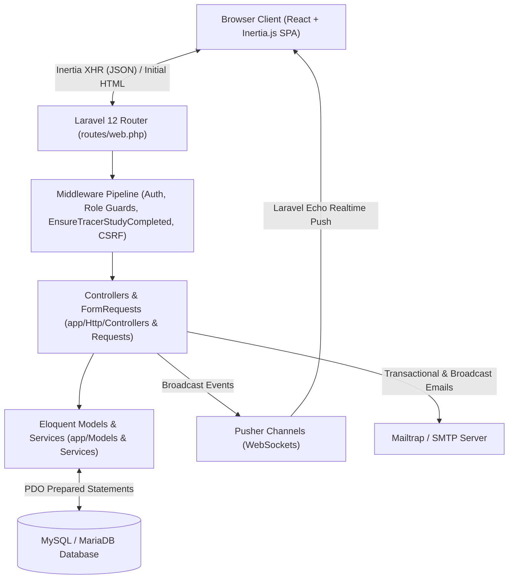

# GATE (Graduate Access and Tracking Environment) — Full System Technical Documentation

**System Title:** GATE: A Web-Based Alumni Tracer Study and Update Portal for the College of Engineering and Computer Technology (CECT), Wesleyan University-Philippines  
**Architecture Standard:** Vibe Code Brain (`docs/brain.txt`) & ISO/IEC 25010 Software Quality Standards  
**Stack:** Laravel 12 (PHP 8.3) · Inertia.js · React · Vite · Tailwind CSS · shadcn/ui · MySQL/MariaDB · Pusher Channels

---

## Table of Contents

1. [Architectural Governance (`docs/brain.txt` Compliance Matrix)](#1-architectural-governance-docsbraintxt-compliance-matrix)
2. [System Architecture & Data Flow](#2-system-architecture--data-flow)
3. [Database Schema & Entity Reference](#3-database-schema--entity-reference)
4. [Complete Backend File Inventory (`app/` & `routes/`)](#4-complete-backend-file-inventory-app--routes)
5. [Complete Frontend File Inventory (`resources/js/`)](#5-complete-frontend-file-inventory-resourcesjs)
6. [Tracer Study Analytics & Statistical Engine Specification](#6-tracer-study-analytics--statistical-engine-specification)
7. [Security Architecture & Defense-in-Depth](#7-security-architecture--defense-in-depth)
8. [Deployment & Shared Hosting Architecture (InfinityFree)](#8-deployment--shared-hosting-architecture-infinityfree)

---

## 1. Architectural Governance (`docs/brain.txt` Compliance Matrix)

All modules in the GATE codebase are engineered and documented around the 10 core rules defined in [`docs/brain.txt`](file:///c:/Users/soria/Documents/GitHub/tracer-study-system/docs/brain.txt):

| Rule # | Principle (`docs/brain.txt`) | Implementation in GATE |
| :--- | :--- | :--- |
| **1** | **Zero Public Exposure of Secrets** | Database credentials, `APP_KEY`, `ADMIN_PORTAL_PREFIX`, SMTP credentials, and Pusher keys are strictly loaded from server-side `.env` via `env()` / `config()`. `.env` is excluded via `.gitignore`. Only public `VITE_PUSHER_*` client keys are exposed to Vite builds. |
| **2** | **Secure-by-Design** | Eloquent ORM and parameterized PDO queries prevent SQL Injection; Form Request classes (`app/Http/Requests/*`) enforce strict input validation; Bcrypt hashes passwords; role middleware (`EnsureAdmin`, `EnsureCoordinator`, `EnsureAlumna`, `EnsureTracerStudyCompleted`) enforces server-side RBAC; `ImageHelper` re-encodes uploads to `.webp` to neutralize polyglot WebShells. |
| **3** | **Exact Delivery Only** | Features map directly to CECT institutional tracer study requirements, CHED Graduate Tracer Study (GTS) instruments, and capstone panel revisions. |
| **4** | **One Thing, One Place (Modular Architecture)** | Reusable UI primitives reside in `resources/js/components/ui/`, role-specific tables/modals in `components/admin/`, `components/coordinator/`, `components/alumna/`, `components/survey/`, and shared utilities in `app/Helpers/ImageHelper.php` and `app/Services/NotificationService.php`. |
| **5** | **Git Safety First** | Additive database migrations (`database/migrations/*`) and non-destructive version control workflows preserve schema and historical data integrity. |
| **6** | **Database-First Integrity** | All queries and relationships strictly align with `docs/gate_db_final.sql` and Laravel migrations (`users`, `addresses`, `employment`, `employment_histories`, `surveys`, `sections`, `subheadings`, `questions`, `responses`, `survey_drafts`, `announcements`, `featured_alumni`, `inquiries`, `inquiry_replies`, `notifications`, `conversations`, `messages`, `departments`, `programs`, `system_settings`). |
| **7** | **Spec-First Protocol** | All major architectural changes (Tracer Gate, Separated Profile vs. Employment Updates, Statistical Analytics Engine) follow a specification-first design before implementation. |
| **8** | **No Ghost Code** | Controllers, policies, and React pages contain complete, production-ready implementations with database transactions (`DB::transaction`) and error handling. |
| **9** | **Controlled Multi-File Impact** | Cross-cutting changes are isolated to specific controller-page pairs via Inertia.js props contracts. |
| **10** | **Testable and Readable** | Explicit method signatures, descriptive variable names, pure helper functions (`renderDonutLabel`, `ImageHelper::storeAsWebp`), and factories (`database/factories/*`) ensure high readability and maintainability. |

---

## 2. System Architecture & Data Flow

### Role-Segmented Portal Architecture
1. **Alumni Portal (`/alumni/*`):**
   - Student ID identity verification (`verifyIdentity`) + credential setup (`setupCredentials`) + signed email verification (`VerifyEmailController`) + mandatory onboarding (`AlumnaOnboarding.jsx`).
   - Protected by `EnsureTracerStudyCompleted` (`tracer.completed` middleware), which locks non-survey pages until the active **Tracer Study** survey is completed.
2. **Coordinator Portal (`/coordinator/*`):**
   - Protected by `EnsureCoordinator` (`coordinator` middleware) and `ForcePasswordChange` for newly created coordinator accounts.
   - Manages **Alumni Forms**, monitors survey responses, manages the alumni directory (including CSV import and bulk email), responds to inquiries, and submits announcements and featured alumni for Admin approval.
3. **Admin Portal (`/{ADMIN_PORTAL_PREFIX}/*`):**
   - Protected by an obfuscated URL prefix configured in `.env` (`ADMIN_PORTAL_PREFIX`) and `EnsureAdmin`.
   - Full authority over **Tracer Study** and **Alumni Forms**, coordinator account management, academic department/program settings, website branding/theme customization, announcement/featured alumni approvals, and advanced Tracer Study Analytics.

---

## 3. Database Schema & Entity Reference

Referenced from [`docs/gate_db_final.sql`](file:///c:/Users/soria/Documents/GitHub/tracer-study-system/docs/gate_db_final.sql) and [`database/migrations/`](file:///c:/Users/soria/Documents/GitHub/tracer-study-system/database/migrations):

| Table Name | Primary Model | Key Columns & Relationships |
| :--- | :--- | :--- |
| `users` | [`User.php`](file:///c:/Users/soria/Documents/GitHub/tracer-study-system/app/Models/User.php) | `id`, `student_id`, `name`, `first_name`, `middle_name`, `last_name`, `suffix`, `email`, `password`, `user_role` (`admin`, `coordinator`, `alumna`), `status` (`active`, `pending`, `inactive`, `archived`), `course`, `year_graduated`, `semester_graduated`, `gender`, `birthday`, `civil_status`, `contact_number`, `avatar`, `email_verified_at`, `must_change_password`, `notifications_seen_at` |
| `addresses` | [`Address.php`](file:///c:/Users/soria/Documents/GitHub/tracer-study-system/app/Models/Address.php) | `id`, `user_id` (FK), `location_type` (`philippines`, `international`), `region_code`, `region_name`, `province_code`, `province_name`, `city_code`, `city_name`, `barangay_code`, `barangay_name`, `country`, `zip_code`, `full_address` |
| `employment` | [`Employment.php`](file:///c:/Users/soria/Documents/GitHub/tracer-study-system/app/Models/Employment.php) | `id`, `user_id` (FK), `employment_status` (`Employed`, `Unemployed`), `company_name`, `position`, `employment_type`, `work_location`, `monthly_salary`, `employment_duration` |
| `employment_histories` | [`EmploymentHistory.php`](file:///c:/Users/soria/Documents/GitHub/tracer-study-system/app/Models/EmploymentHistory.php) | `id`, `user_id` (FK), `employment_status`, `company`, `position`, `employment_type`, `location`, `monthly_salary`, `employment_duration`, `recorded_at` |
| `departments` | [`Department.php`](file:///c:/Users/soria/Documents/GitHub/tracer-study-system/app/Models/Department.php) | `id`, `name`, `code`, `description`, `is_active` |
| `programs` | [`Program.php`](file:///c:/Users/soria/Documents/GitHub/tracer-study-system/app/Models/Program.php) | `id`, `department_id` (FK), `code` (`BSIT`, `BSCpE`, `BSEcE`, `BSCS`), `name`, `is_active` |
| `surveys` | [`Survey.php`](file:///c:/Users/soria/Documents/GitHub/tracer-study-system/app/Models/Survey.php) | `id`, `title`, `description`, `type` (`Tracer Study`, `Alumni Forms`), `status` (`draft`, `active`, `archived`), `created_by` (FK), `start_date`, `end_date`, `is_anonymous` |
| `sections` | [`Section.php`](file:///c:/Users/soria/Documents/GitHub/tracer-study-system/app/Models/Section.php) | `id`, `survey_id` (FK), `title`, `description`, `order_index` |
| `subheadings` | [`Subheading.php`](file:///c:/Users/soria/Documents/GitHub/tracer-study-system/app/Models/Subheading.php) | `id`, `section_id` (FK), `title`, `description`, `order_index` |
| `questions` | [`Question.php`](file:///c:/Users/soria/Documents/GitHub/tracer-study-system/app/Models/Question.php) | `id`, `section_id` (FK), `subheading_id` (FK nullable), `question_text`, `question_type` (`text`, `textarea`, `number`, `date`, `radio`, `checkbox`, `dropdown`, `scale`, `rating`, `likert`), `options` (JSON), `is_required`, `order_index`, `conditional_logic` (JSON) |
| `responses` | [`Response.php`](file:///c:/Users/soria/Documents/GitHub/tracer-study-system/app/Models/Response.php) | `id`, `survey_id` (FK), `user_id` (FK), `question_id` (FK), `answer` (Text/JSON), `submitted_at` |
| `survey_drafts` | [`SurveyDraft.php`](file:///c:/Users/soria/Documents/GitHub/tracer-study-system/app/Models/SurveyDraft.php) | `id`, `survey_id` (FK), `user_id` (FK), `answers` (JSON), `current_section` |
| `announcements` | [`Announcement.php`](file:///c:/Users/soria/Documents/GitHub/tracer-study-system/app/Models/Announcement.php) | `id`, `user_id` (FK), `title`, `content`, `category`, `image`, `status` (`Pending`, `Approved`, `Rejected`), `rejection_reason` |
| `featured_alumni` | [`FeaturedAlumni.php`](file:///c:/Users/soria/Documents/GitHub/tracer-study-system/app/Models/FeaturedAlumni.php) | `id`, `user_id` (FK), `name`, `course`, `batch_year`, `current_position`, `company`, `story`, `quote`, `image`, `status` (`Pending`, `Approved`, `Rejected`), `rejection_reason` |
| `inquiries` & `inquiry_replies` | [`Inquiries.php`](file:///c:/Users/soria/Documents/GitHub/tracer-study-system/app/Models/Inquiries.php), [`InquiryReply.php`](file:///c:/Users/soria/Documents/GitHub/tracer-study-system/app/Models/InquiryReply.php) | Threaded alumni-to-staff support tickets with status tracking (`Pending`, `In Progress`, `Resolved`) and email/realtime notifications |
| `notifications` & `notification_reads` | [`Notification.php`](file:///c:/Users/soria/Documents/GitHub/tracer-study-system/app/Models/Notification.php), [`NotificationRead.php`](file:///c:/Users/soria/Documents/GitHub/tracer-study-system/app/Models/NotificationRead.php) | Role-targeted and user-targeted notifications with per-user read state tracking |
| `conversations`, `messages`, `message_reads` | [`Conversation.php`](file:///c:/Users/soria/Documents/GitHub/tracer-study-system/app/Models/Conversation.php), [`Message.php`](file:///c:/Users/soria/Documents/GitHub/tracer-study-system/app/Models/Message.php) | Real-time direct messaging between staff and alumni |
| `system_settings` | [`SystemSetting.php`](file:///c:/Users/soria/Documents/GitHub/tracer-study-system/app/Models/SystemSetting.php) | Key-value store for dynamic branding (logos, hero backgrounds, portal titles) and theme color palettes |

---

## 4. Complete Backend File Inventory (`app/` & `routes/`)

### 4.1 Authentication Controllers (`app/Http/Controllers/Auth/`)
- [`AdminAuthController.php`](file:///c:/Users/soria/Documents/GitHub/tracer-study-system/app/Http/Controllers/Auth/AdminAuthController.php): Handles Admin login under the obfuscated prefix, session regeneration, role verification, and logout.
- [`AlumnaAuthController.php`](file:///c:/Users/soria/Documents/GitHub/tracer-study-system/app/Http/Controllers/Auth/AlumnaAuthController.php): Handles Alumni login, Student ID identity verification (`verifyIdentity`), initial credential setup (`setupCredentials`), cross-device verification polling (`checkVerificationStatus`), and post-verification onboarding (`showOnboarding`, `completeOnboarding`).
- [`CoordinatorAuthController.php`](file:///c:/Users/soria/Documents/GitHub/tracer-study-system/app/Http/Controllers/Auth/CoordinatorAuthController.php): Handles Coordinator login, mandatory first-login password change (`showChangePassword`, `changePassword`), and logout.
- [`VerifyEmailController.php`](file:///c:/Users/soria/Documents/GitHub/tracer-study-system/app/Http/Controllers/Auth/VerifyEmailController.php): Validates HMAC-signed verification URLs (`signed:relative`), marks `email_verified_at`, activates the account, and logs the user in for onboarding.
- [`EmailVerificationNotificationController.php`](file:///c:/Users/soria/Documents/GitHub/tracer-study-system/app/Http/Controllers/Auth/EmailVerificationNotificationController.php): Rate-limited (`throttle:6,1`) endpoint to resend verification links.
- [`ForgotPasswordController.php`](file:///c:/Users/soria/Documents/GitHub/tracer-study-system/app/Http/Controllers/Auth/ForgotPasswordController.php) & [`ResetPasswordController.php`](file:///c:/Users/soria/Documents/GitHub/tracer-study-system/app/Http/Controllers/Auth/ResetPasswordController.php): Password reset token dispatch and password update handlers.

### 4.2 Admin Controllers (`app/Http/Controllers/Admin/`)
- [`AdminDashboardController.php`](file:///c:/Users/soria/Documents/GitHub/tracer-study-system/app/Http/Controllers/Admin/AdminDashboardController.php): Aggregates KPI metrics (total alumni, employed count, survey completion rates, pending approvals, recent activities, and course distribution charts).
- [`AdminAlumniController.php`](file:///c:/Users/soria/Documents/GitHub/tracer-study-system/app/Http/Controllers/Admin/AdminAlumniController.php): Full CRUD, filtering, archiving/restoring, profile inspection, individual email dispatch, and bulk email broadcasting (`SendAlumniBroadcastJob`) for alumni records.
- [`AdminAlumniCoordinatorController.php`](file:///c:/Users/soria/Documents/GitHub/tracer-study-system/app/Http/Controllers/Admin/AdminAlumniCoordinatorController.php): Manages coordinator accounts, generates temporary passwords, and dispatches [`CoordinatorWelcomeMail.php`](file:///c:/Users/soria/Documents/GitHub/tracer-study-system/app/Mail/CoordinatorWelcomeMail.php).
- [`AdminOfSurveyResponseController.php`](file:///c:/Users/soria/Documents/GitHub/tracer-study-system/app/Http/Controllers/Admin/AdminOfSurveyResponseController.php): Lists surveys with response counts, shows respondent tables (completed vs. draft/in-progress), views individual user answers, and deletes responses.
- [`AdminProfileController.php`](file:///c:/Users/soria/Documents/GitHub/tracer-study-system/app/Http/Controllers/Admin/AdminProfileController.php): Admin account profile and password management.
- [`AdminSettingsController.php`](file:///c:/Users/soria/Documents/GitHub/tracer-study-system/app/Http/Controllers/Admin/AdminSettingsController.php): Academic Department and Degree Program CRUD (`departments` and `programs` tables).
- [`AdminThemeSettingsController.php`](file:///c:/Users/soria/Documents/GitHub/tracer-study-system/app/Http/Controllers/Admin/AdminThemeSettingsController.php): Dynamic branding (logos, cover images via `ImageHelper`) and CSS theme variable customization stored in `system_settings`.

### 4.3 Coordinator Controllers (`app/Http/Controllers/Coordinator/`)
- [`CoordinatorDashboardController.php`](file:///c:/Users/soria/Documents/GitHub/tracer-study-system/app/Http/Controllers/Coordinator/CoordinatorDashboardController.php): Coordinator overview metrics and recent activity feed.
- [`CoordinatorAlumniController.php`](file:///c:/Users/soria/Documents/GitHub/tracer-study-system/app/Http/Controllers/Coordinator/CoordinatorAlumniController.php): Alumni directory management, CSV bulk import (`importCsv`), sample CSV generator (`downloadSampleCsv`), and individual/bulk email tools.
- [`CoordinatorOfSurveyResponseController.php`](file:///c:/Users/soria/Documents/GitHub/tracer-study-system/app/Http/Controllers/Coordinator/CoordinatorOfSurveyResponseController.php): Coordinator view of survey respondents, individual completed submissions, and in-progress drafts.
- [`CoordinatorProfileController.php`](file:///c:/Users/soria/Documents/GitHub/tracer-study-system/app/Http/Controllers/Coordinator/CoordinatorProfileController.php): Coordinator profile view and update logic.

### 4.4 Shared & Core Domain Controllers (`app/Http/Controllers/`)
- [`SurveyAnalyticsController.php`](file:///c:/Users/soria/Documents/GitHub/tracer-study-system/app/Http/Controllers/SurveyAnalyticsController.php): Primary analytics engine for **Tracer Study Analytics**, **Alumni Forms Analytics**, and **Employment Location Analytics** (see Section 6 for full mathematical and algorithmic details).
- [`CectSurveyAnalyticsController.php`](file:///c:/Users/soria/Documents/GitHub/tracer-study-system/app/Http/Controllers/CectSurveyAnalyticsController.php): Specialized CECT CHED GTS tabular breakdown and CSV export controller.
- [`SurveyController.php`](file:///c:/Users/soria/Documents/GitHub/tracer-study-system/app/Http/Controllers/SurveyController.php), [`SectionController.php`](file:///c:/Users/soria/Documents/GitHub/tracer-study-system/app/Http/Controllers/SectionController.php), [`SubheadingController.php`](file:///c:/Users/soria/Documents/GitHub/tracer-study-system/app/Http/Controllers/SubheadingController.php), [`QuestionController.php`](file:///c:/Users/soria/Documents/GitHub/tracer-study-system/app/Http/Controllers/QuestionController.php): Interactive Survey Builder CRUD, drag-and-drop reordering, conditional logic configuration, and survey lifecycle transitions (`draft` → `active` → `archived`).
- [`SurveyResponseController.php`](file:///c:/Users/soria/Documents/GitHub/tracer-study-system/app/Http/Controllers/SurveyResponseController.php) & [`QuestionnaireController.php`](file:///c:/Users/soria/Documents/GitHub/tracer-study-system/app/Http/Controllers/QuestionnaireController.php): Alumni survey rendering, section-by-section draft autosaving (`survey_drafts`), final submission (`responses`), and automated synchronization of tracer employment answers with the `employment` and `employment_histories` tables.
- [`AlumnaHomeController.php`](file:///c:/Users/soria/Documents/GitHub/tracer-study-system/app/Http/Controllers/AlumnaHomeController.php): Renders the Alumni Home page with latest approved announcements, active surveys, featured alumni spotlights, and profile freshness status.
- [`Studentprofilecontroller.php`](file:///c:/Users/soria/Documents/GitHub/tracer-study-system/app/Http/Controllers/Studentprofilecontroller.php): Manages personal, academic, and PSGC/International address profiles (`/alumni/profile` and `/alumni/profile/edit`).
- [`AlumnaUpdatesController.php`](file:///c:/Users/soria/Documents/GitHub/tracer-study-system/app/Http/Controllers/AlumnaUpdatesController.php): Dedicated career/employment status update module (`/alumni/updates`) that updates `employment` and appends a chronological snapshot to `employment_histories`.
- [`AnnouncementController.php`](file:///c:/Users/soria/Documents/GitHub/tracer-study-system/app/Http/Controllers/AnnouncementController.php): Multi-role announcement CRUD with Admin approval/rejection workflow and realtime Pusher notifications (`AnnouncementPublished`, `AnnouncementStatusChanged`).
- [`FeaturedAlumniController.php`](file:///c:/Users/soria/Documents/GitHub/tracer-study-system/app/Http/Controllers/FeaturedAlumniController.php): Multi-role Featured Alumni showcase CRUD with Admin approval/rejection workflow.
- [`InquiriesController.php`](file:///c:/Users/soria/Documents/GitHub/tracer-study-system/app/Http/Controllers/InquiriesController.php): Alumni inquiry submission, quick-inquiry modal handler, staff reply threads, email notifications (`InquiryReplied` Mailable), and realtime Pusher broadcasts (`InquiryCreated`, `InquiryReplied`).
- [`NotificationController.php`](file:///c:/Users/soria/Documents/GitHub/tracer-study-system/app/Http/Controllers/NotificationController.php) & [`ChatController.php`](file:///c:/Users/soria/Documents/GitHub/tracer-study-system/app/Http/Controllers/ChatController.php): Endpoints for the notification bell dropdown and real-time messenger.

### 4.5 Middleware, Helpers, Services, Policies & Events
- **Middleware (`app/Http/Middleware/`):**
  - [`EnsureAdmin.php`](file:///c:/Users/soria/Documents/GitHub/tracer-study-system/app/Http/Middleware/EnsureAdmin.php), [`EnsureCoordinator.php`](file:///c:/Users/soria/Documents/GitHub/tracer-study-system/app/Http/Middleware/EnsureCoordinator.php), [`EnsureAlumna.php`](file:///c:/Users/soria/Documents/GitHub/tracer-study-system/app/Http/Middleware/EnsureAlumna.php): Strict role guards returning HTTP 403 on unauthorized role access.
  - [`EnsureTracerStudyCompleted.php`](file:///c:/Users/soria/Documents/GitHub/tracer-study-system/app/Http/Middleware/EnsureTracerStudyCompleted.php): Intercepts authenticated alumni who have not yet completed the active Tracer Study survey or onboarding and redirects them to `/alumni/surveys/{id}` or `/alumni/profile-setup`.
  - [`ForcePasswordChange.php`](file:///c:/Users/soria/Documents/GitHub/tracer-study-system/app/Http/Middleware/ForcePasswordChange.php): Redirects coordinators with `must_change_password = true` to the password change screen.
  - [`HandleInertiaRequests.php`](file:///c:/Users/soria/Documents/GitHub/tracer-study-system/app/Http/Middleware/HandleInertiaRequests.php): Injects shared Inertia props (`auth.user`, `flash`, `ziggy`, `systemSettings`, unread notification counts, and active tracer status) into every page render.
- **Helpers & Services:**
  - [`ImageHelper.php`](file:///c:/Users/soria/Documents/GitHub/tracer-study-system/app/Helpers/ImageHelper.php): Converts uploaded JPEG/PNG/GIF/WebP images into compressed `.webp` files using PHP GD, strips EXIF/metadata payloads, and stores them directly in `public/storage/` to support shared hosting without symlinks.
  - [`NotificationService.php`](file:///c:/Users/soria/Documents/GitHub/tracer-study-system/app/Services/NotificationService.php): Centralized dispatcher that persists notifications to MySQL and broadcasts `NotificationCreated` over Pusher Channels.
- **Policies (`app/Policies/`):**
  - [`SurveyPolicy.php`](file:///c:/Users/soria/Documents/GitHub/tracer-study-system/app/Policies/SurveyPolicy.php) & [`SurveyDraftPolicy.php`](file:///c:/Users/soria/Documents/GitHub/tracer-study-system/app/Policies/SurveyDraftPolicy.php): Enforces that only Admins can create/modify `Tracer Study` surveys while allowing Coordinators to manage `Alumni Forms`.

---

## 5. Complete Frontend File Inventory (`resources/js/`)

### 5.1 Core Entry Points & Layouts (`resources/js/layouts/`)
- [`app.jsx`](file:///c:/Users/soria/Documents/GitHub/tracer-study-system/resources/js/app.jsx): Inertia React client bootstrap with dynamic page resolution and global providers.
- [`echo.js`](file:///c:/Users/soria/Documents/GitHub/tracer-study-system/resources/js/echo.js): Laravel Echo + Pusher JS client initialization for real-time websockets.
- [`admin-layout.jsx`](file:///c:/Users/soria/Documents/GitHub/tracer-study-system/resources/js/layouts/admin-layout.jsx) & [`sidebar-admin.jsx`](file:///c:/Users/soria/Documents/GitHub/tracer-study-system/resources/js/components/sidebar-admin.jsx): Admin portal shell with collapsible navigation groups (*General*, *Survey Management*, *Analytics*, *User Management*, *System Settings*).
- [`coord-layout.jsx`](file:///c:/Users/soria/Documents/GitHub/tracer-study-system/resources/js/layouts/coord-layout.jsx) & [`sidebar-coord.jsx`](file:///c:/Users/soria/Documents/GitHub/tracer-study-system/resources/js/components/sidebar-coord.jsx): Coordinator portal shell.
- [`alumna-layout.jsx`](file:///c:/Users/soria/Documents/GitHub/tracer-study-system/resources/js/layouts/alumna-layout.jsx) & [`navbar-alumni.jsx`](file:///c:/Users/soria/Documents/GitHub/tracer-study-system/resources/js/components/navbar-alumni.jsx): Mobile-first alumni layout with left slide-out drawer navigation (*Quick Actions* and *Alumni Affairs*), 3-month profile freshness reminder ([`UpdateProfileBanner.jsx`](file:///c:/Users/soria/Documents/GitHub/tracer-study-system/resources/js/components/alumna/UpdateProfileBanner.jsx)), and notification bell.

### 5.2 Pages by Role (`resources/js/pages/`)
- **Authentication (`resources/js/pages/Auth/`):**
  - [`AlumnaLogin.jsx`](file:///c:/Users/soria/Documents/GitHub/tracer-study-system/resources/js/pages/Auth/AlumnaLogin.jsx): Unified Alumni Login & Student ID Verification modal flow.
  - [`VerifyEmail.jsx`](file:///c:/Users/soria/Documents/GitHub/tracer-study-system/resources/js/pages/Auth/VerifyEmail.jsx): Email verification waiting screen with cross-device polling (`check-verification-status`) and resend cooldown timer.
  - [`AlumnaOnboarding.jsx`](file:///c:/Users/soria/Documents/GitHub/tracer-study-system/resources/js/pages/Auth/AlumnaOnboarding.jsx): Post-verification profile completion wizard.
  - [`AdminLogin.jsx`](file:///c:/Users/soria/Documents/GitHub/tracer-study-system/resources/js/pages/Auth/AdminLogin.jsx), [`CoordinatorLogin.jsx`](file:///c:/Users/soria/Documents/GitHub/tracer-study-system/resources/js/pages/Auth/CoordinatorLogin.jsx), [`ForgotPassword.jsx`](file:///c:/Users/soria/Documents/GitHub/tracer-study-system/resources/js/pages/Auth/ForgotPassword.jsx), [`ResetPassword.jsx`](file:///c:/Users/soria/Documents/GitHub/tracer-study-system/resources/js/pages/Auth/ResetPassword.jsx).
- **Admin Pages (`resources/js/pages/Admin/`):**
  - [`AdminDashboard.jsx`](file:///c:/Users/soria/Documents/GitHub/tracer-study-system/resources/js/pages/Admin/AdminDashboard.jsx): Executive summary cards, response charts, and quick actions.
  - [`SurveyAnalytics.jsx`](file:///c:/Users/soria/Documents/GitHub/tracer-study-system/resources/js/pages/Admin/SurveyAnalytics.jsx): Comprehensive Tracer Study & Alumni Forms Analytics dashboard (see Section 6).
  - [`CectSurveyAnalytics.jsx`](file:///c:/Users/soria/Documents/GitHub/tracer-study-system/resources/js/pages/Admin/CectSurveyAnalytics.jsx): CECT-specific tabular question breakdown and export view.
  - [`EmploymentLocationAnalytics.jsx`](file:///c:/Users/soria/Documents/GitHub/tracer-study-system/resources/js/pages/Admin/EmploymentLocationAnalytics.jsx): Interactive Philippine regional/provincial & international employment distribution analytics.
  - [`AnalyticsIndex.jsx`](file:///c:/Users/soria/Documents/GitHub/tracer-study-system/resources/js/pages/Admin/AnalyticsIndex.jsx): Survey selector for Tracer Study and Alumni Forms analytics.
  - [`SurveyIndex.jsx`](file:///c:/Users/soria/Documents/GitHub/tracer-study-system/resources/js/pages/Admin/SurveyIndex.jsx) & [`SurveyBuilder.jsx`](file:///c:/Users/soria/Documents/GitHub/tracer-study-system/resources/js/pages/Admin/SurveyBuilder.jsx): Drag-and-drop survey, section, subheading, and question builder.
  - [`AdminSurveyResponseIndex.jsx`](file:///c:/Users/soria/Documents/GitHub/tracer-study-system/resources/js/pages/Admin/AdminSurveyResponseIndex.jsx), [`AdminSurveyResponse.jsx`](file:///c:/Users/soria/Documents/GitHub/tracer-study-system/resources/js/pages/Admin/AdminSurveyResponse.jsx), [`AdminSurveyResponseView.jsx`](file:///c:/Users/soria/Documents/GitHub/tracer-study-system/resources/js/pages/Admin/AdminSurveyResponseView.jsx), [`AdminSurveyResponseViewNotComplete.jsx`](file:///c:/Users/soria/Documents/GitHub/tracer-study-system/resources/js/pages/Admin/AdminSurveyResponseViewNotComplete.jsx): Respondent monitoring and individual submission viewers.
  - [`AdminAlumni.jsx`](file:///c:/Users/soria/Documents/GitHub/tracer-study-system/resources/js/pages/Admin/AdminAlumni.jsx) & [`AdminViewProfileOfRespondents.jsx`](file:///c:/Users/soria/Documents/GitHub/tracer-study-system/resources/js/pages/Admin/AdminViewProfileOfRespondents.jsx): Alumni directory, profile modal, employment history timeline, and bulk email sender.
  - [`AdminAlumniCoordinator.jsx`](file:///c:/Users/soria/Documents/GitHub/tracer-study-system/resources/js/pages/Admin/AdminAlumniCoordinator.jsx) & [`AdminAlumniCoordinatorView.jsx`](file:///c:/Users/soria/Documents/GitHub/tracer-study-system/resources/js/pages/Admin/AdminAlumniCoordinatorView.jsx): Coordinator account management.
  - [`AdminAnnouncement.jsx`](file:///c:/Users/soria/Documents/GitHub/tracer-study-system/resources/js/pages/Admin/AdminAnnouncement.jsx), [`AdminAnnouncementCreate.jsx`](file:///c:/Users/soria/Documents/GitHub/tracer-study-system/resources/js/pages/Admin/AdminAnnouncementCreate.jsx), [`AdminAnnouncementEdit.jsx`](file:///c:/Users/soria/Documents/GitHub/tracer-study-system/resources/js/pages/Admin/AdminAnnouncementEdit.jsx), [`AdminAnnouncementView.jsx`](file:///c:/Users/soria/Documents/GitHub/tracer-study-system/resources/js/pages/Admin/AdminAnnouncementView.jsx): Announcement management and coordinator post approval.
  - [`AdminFeaturedAlumni.jsx`](file:///c:/Users/soria/Documents/GitHub/tracer-study-system/resources/js/pages/Admin/AdminFeaturedAlumni.jsx), [`AdminFeaturedAlumniCreate.jsx`](file:///c:/Users/soria/Documents/GitHub/tracer-study-system/resources/js/pages/Admin/AdminFeaturedAlumniCreate.jsx), [`AdminFeaturedAlumniEdit.jsx`](file:///c:/Users/soria/Documents/GitHub/tracer-study-system/resources/js/pages/Admin/AdminFeaturedAlumniEdit.jsx), [`AdminFeaturedAlumniView.jsx`](file:///c:/Users/soria/Documents/GitHub/tracer-study-system/resources/js/pages/Admin/AdminFeaturedAlumniView.jsx): Featured Alumni spotlight management and approval.
  - [`AdminInquiries.jsx`](file:///c:/Users/soria/Documents/GitHub/tracer-study-system/resources/js/pages/Admin/AdminInquiries.jsx): Staff inquiry helpdesk.
  - [`AdminSettings.jsx`](file:///c:/Users/soria/Documents/GitHub/tracer-study-system/resources/js/pages/Admin/AdminSettings.jsx) & [`AdminThemeSettings.jsx`](file:///c:/Users/soria/Documents/GitHub/tracer-study-system/resources/js/pages/Admin/AdminThemeSettings.jsx): Academic programs and portal theme/branding settings.
- **Alumna Pages (`resources/js/pages/Alumna/`):**
  - [`AlumnaHome.jsx`](file:///c:/Users/soria/Documents/GitHub/tracer-study-system/resources/js/pages/Alumna/AlumnaHome.jsx), [`AlumnaQuestionnaire.jsx`](file:///c:/Users/soria/Documents/GitHub/tracer-study-system/resources/js/pages/Alumna/AlumnaQuestionnaire.jsx), [`Survey.jsx`](file:///c:/Users/soria/Documents/GitHub/tracer-study-system/resources/js/pages/Alumna/Survey.jsx), [`StudentProfile.jsx`](file:///c:/Users/soria/Documents/GitHub/tracer-study-system/resources/js/pages/Alumna/StudentProfile.jsx), [`StudentProfileEdit.jsx`](file:///c:/Users/soria/Documents/GitHub/tracer-study-system/resources/js/pages/Alumna/StudentProfileEdit.jsx), [`AlumnaUpdates.jsx`](file:///c:/Users/soria/Documents/GitHub/tracer-study-system/resources/js/pages/Alumna/AlumnaUpdates.jsx), [`HistoryDetail.jsx`](file:///c:/Users/soria/Documents/GitHub/tracer-study-system/resources/js/pages/Alumna/HistoryDetail.jsx), [`AlumnaAnnouncements.jsx`](file:///c:/Users/soria/Documents/GitHub/tracer-study-system/resources/js/pages/Alumna/AlumnaAnnouncements.jsx), [`AlumnaFeaturedAlumni.jsx`](file:///c:/Users/soria/Documents/GitHub/tracer-study-system/resources/js/pages/Alumna/AlumnaFeaturedAlumni.jsx), [`AlumnaInquiries.jsx`](file:///c:/Users/soria/Documents/GitHub/tracer-study-system/resources/js/pages/Alumna/AlumnaInquiries.jsx), [`ContactUs.jsx`](file:///c:/Users/soria/Documents/GitHub/tracer-study-system/resources/js/pages/Alumna/ContactUs.jsx), [`AlumnaAssociation.jsx`](file:///c:/Users/soria/Documents/GitHub/tracer-study-system/resources/js/pages/Alumna/AlumnaAssociation.jsx), [`AlumnaOffice.jsx`](file:///c:/Users/soria/Documents/GitHub/tracer-study-system/resources/js/pages/Alumna/AlumnaOffice.jsx), [`AlumnaAbout.jsx`](file:///c:/Users/soria/Documents/GitHub/tracer-study-system/resources/js/pages/Alumna/AlumnaAbout.jsx), [`AlumnaBenefits.jsx`](file:///c:/Users/soria/Documents/GitHub/tracer-study-system/resources/js/pages/Alumna/AlumnaBenefits.jsx).
- **Coordinator Pages (`resources/js/pages/Coordinator/`):**
  - [`CoordinatorDashboard.jsx`](file:///c:/Users/soria/Documents/GitHub/tracer-study-system/resources/js/pages/Coordinator/CoordinatorDashboard.jsx), [`CoordinatorAlumni.jsx`](file:///c:/Users/soria/Documents/GitHub/tracer-study-system/resources/js/pages/Coordinator/CoordinatorAlumni.jsx), [`CoordinatorSurveyIndex.jsx`](file:///c:/Users/soria/Documents/GitHub/tracer-study-system/resources/js/pages/Coordinator/CoordinatorSurveyIndex.jsx), [`CoordinatorSurveyBuilder.jsx`](file:///c:/Users/soria/Documents/GitHub/tracer-study-system/resources/js/pages/Coordinator/CoordinatorSurveyBuilder.jsx), [`CoordinatorSurveyResponseIndex.jsx`](file:///c:/Users/soria/Documents/GitHub/tracer-study-system/resources/js/pages/Coordinator/CoordinatorSurveyResponseIndex.jsx), [`CoordinatorAnalyticsIndex.jsx`](file:///c:/Users/soria/Documents/GitHub/tracer-study-system/resources/js/pages/Coordinator/CoordinatorAnalyticsIndex.jsx), [`CectSurveyAnalytics.jsx`](file:///c:/Users/soria/Documents/GitHub/tracer-study-system/resources/js/pages/Coordinator/CectSurveyAnalytics.jsx), [`CoordinatorAnnouncement.jsx`](file:///c:/Users/soria/Documents/GitHub/tracer-study-system/resources/js/pages/Coordinator/CoordinatorAnnouncement.jsx), [`CoordinatorFeaturedAlumni.jsx`](file:///c:/Users/soria/Documents/GitHub/tracer-study-system/resources/js/pages/Coordinator/CoordinatorFeaturedAlumni.jsx), [`CoordinatorInquiries.jsx`](file:///c:/Users/soria/Documents/GitHub/tracer-study-system/resources/js/pages/Coordinator/CoordinatorInquiries.jsx), [`CoordinatorProfile.jsx`](file:///c:/Users/soria/Documents/GitHub/tracer-study-system/resources/js/pages/Coordinator/CoordinatorProfile.jsx).

---

## 6. Tracer Study Analytics & Statistical Engine Specification

Implemented in [`SurveyAnalyticsController.php`](file:///c:/Users/soria/Documents/GitHub/tracer-study-system/app/Http/Controllers/SurveyAnalyticsController.php) ([`show`](file:///c:/Users/soria/Documents/GitHub/tracer-study-system/app/Http/Controllers/SurveyAnalyticsController.php#L102-L426)) and rendered in [`SurveyAnalytics.jsx`](file:///c:/Users/soria/Documents/GitHub/tracer-study-system/resources/js/pages/Admin/SurveyAnalytics.jsx) ([`SurveyAnalytics`](file:///c:/Users/soria/Documents/GitHub/tracer-study-system/resources/js/pages/Admin/SurveyAnalytics.jsx#L101-L654)).

### 6.1 Per-Course Sample-Size Target & Progress Indicator
- **Formula:** Uses **Slovin’s Formula** at a **95% confidence level** (margin of error $e = 0.05$):
  $$n_{\text{target}} = \left\lceil \frac{N}{1 + N \cdot e^2} \right\rceil$$
  where $N$ is the total number of registered active alumni (`user_role = 'alumna'` and `status = 'active'`) in each CECT course (`BSIT`, `BSCpE`, `BSEcE`, `BSCS`, etc.).
- **Metrics Computed (`$sampleTargets`):**
  - `population`: Total registered alumni in that course ($N$).
  - `target`: Required sample size ($n_{\text{target}}$).
  - `responded`: Number of alumni in that course who answered the tracer survey.
  - `progress_pct`: $\min\left(100, \text{round}\left(\frac{\text{responded}}{\text{target}} \times 100, 1\right)\right)$.
  - `response_rate`: $\text{round}\left(\frac{\text{responded}}{N} \times 100, 1\right)$.
  - `target_met`: Boolean (`responded >= target`).

### 6.2 Respondent-vs-Population Comparison Report
- Compares **who answered the tracer survey** (`responded`) directly against **those registered in the active alumni list** (`population`) per program (`$populationComparison`):
  - Summary KPIs: **Total in Alumni List**, **Answered Tracer Survey** (with completion rate %), and **Not Yet Answered** (`not_responded = max(0, population - responded)`).
  - Per-Course Comparison Table: Displays Course/Program, In Alumni List, Answered Survey, Not Answered, Turnout Rate %, and user-friendly Response Status badge.

### 6.3 Course-Specific Job-to-Course Relevance Analysis
- **Evaluation Criterion:** Evaluates employed alumni strictly by matching the graduate’s reported **job title/position** and **company/industry** against their respective degree program’s domain keyword dictionary (`$courseDomainConfig` in [`SurveyAnalyticsController.php`](file:///c:/Users/soria/Documents/GitHub/tracer-study-system/app/Http/Controllers/SurveyAnalyticsController.php#L276-L315)).
- **Dynamic Course-Specific Labels:**
  - `BSIT`: **`IT Related`** (green `#008236`) vs. **`Not IT Related`** (red `#E70813`)
  - `BSCpE`: **`CpE Related`** vs. **`Not CpE Related`**
  - `BSEcE`: **`EcE Related`** vs. **`Not EcE Related`**
  - `BSCS`: **`CS Related`** vs. **`Not CS Related`**
  - `All Courses`: **`Course Related`** vs. **`Not Course Related`**
- **Visualizations & Job Listings:**
  - Interactive course filter pills (`All Courses`, `BSIT`, `BSCpE`, `BSEcE`, etc.) in the card header.
  - Donut `PieChart` showing the exact percentage split and persistent two-item legend (`relLegendPayload`).
  - Side-by-side **Relevant Jobs** and **Non-Relevant Jobs** lists showing the exact job position, company/industry, course badge, relevance label, and respondent count.

### 6.4 Minimum Response Threshold & User-Friendly Suppression Rule
- **Thresholds (`$thresholdRules`):**
  - **Suppression Threshold (`< 5` responses):** Subgroups with fewer than 5 responses have sensitive averages (such as average salary or course-level relevance percentages when under threshold) hidden or flagged with clear, non-technical labels (`"Too Few Responses (Under 5)"`, `"Needs at least 5 responses"`, `"Not Enough Data"`).
  - **Low Response Caution (`5–9` responses):** Subgroups with 5 to 9 responses are displayed with a yellow caution badge (`"Low Responses (5–9)"` / `"Low Turnout"`).
  - **Sufficient Responses (`10+` responses):** Marked with a green badge (`"Enough Responses"`).
- **Placeholder Sanitization:** Filters out non-meaningful placeholder strings (`*`, `N/A`, `na`, `none`, `-`, `unemployed`) submitted by unemployed respondents so they do not pollute the **Top Industries / Companies** ranking.

---

## 7. Security Architecture & Defense-in-Depth

For a complete code-level Q&A defense guide, see [`docs/SECURITY_DEFENSE_QNA.md`](file:///c:/Users/soria/Documents/GitHub/tracer-study-system/docs/SECURITY_DEFENSE_QNA.md). Key security controls include:

1. **Obfuscated Admin Portal Gateway:** Configured via `ADMIN_PORTAL_PREFIX` in `.env` (`routes/web.php#L208`), preventing automated bots from discovering `/admin/login`.
2. **Session Fixation & CSRF Protection:** Explicit `$request->session()->regenerate()` on authentication and `$request->session()->invalidate()` + `regenerateToken()` on logout across all three auth controllers.
3. **HMAC-Signed Email Verification:** Uses `signed:relative` middleware (`routes/web.php#L104`) so verification links cannot be forged or tampered with, while remaining compatible with reverse proxies and shared hosting.
4. **Server-Side Mandatory Tracer Gate:** [`EnsureTracerStudyCompleted.php`](file:///c:/Users/soria/Documents/GitHub/tracer-study-system/app/Http/Middleware/EnsureTracerStudyCompleted.php) enforces survey completion on the backend request lifecycle, preventing client-side bypasses.
5. **WebShell Neutralization via GD Re-encoding:** [`ImageHelper.php`](file:///c:/Users/soria/Documents/GitHub/tracer-study-system/app/Helpers/ImageHelper.php) parses uploaded image binaries into memory via PHP GD and writes a brand-new `.webp` stream with a randomized filename (`uniqid() . '_' . time() . '.webp'`), destroying any embedded PHP payload.

---

## 8. Deployment & Shared Hosting Architecture (InfinityFree)

- **Build Process:** Frontend assets are compiled locally via `npm run build` (Vite bundle output in `public/build/`) and uploaded via FTP (FileZilla) alongside the Laravel codebase.
- **No-Symlink Public Storage:** Because shared hosting disables `exec()`/`symlink()` (`php artisan storage:link`), [`ImageHelper.php`](file:///c:/Users/soria/Documents/GitHub/tracer-study-system/app/Helpers/ImageHelper.php) writes optimized `.webp` files directly to `public/storage/{directory}` and serves them via `/storage/{directory}/{filename}`.
- **Realtime Without Cron/Supervisor:** Uses Pusher Channels (`BROADCAST_CONNECTION=pusher`) for instant websocket event delivery without requiring background daemon workers on the shared host.

